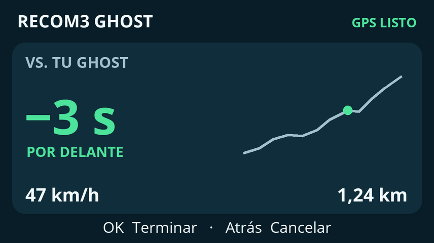

# Recom3 Ghost

An offline ski ghost app for Recon Snow2. Record a downhill run, then ski the same route again to see how far ahead or behind you are on the HUD. The app stores one reference run on the device. It uses fonts and a font loader from `reconUI` and follows Snow2Liftie's example for the full-screen theme and D-pad controls.

## HUD preview



*Preview of the current HUD during a run, with sample data.*

## How to use

1. Open **Recom3 Ghost** on the HUD and wait for **GPS LISTO** (GPS ready).
2. At the start of the run, press **OK**. Recording begins with the next valid GPS fix. Press **OK** at the end of the run to save it as your reference.
3. Return to the same starting point and press **OK** to race your ghost. A negative time means you are ahead. Press **OK** near the finish to end the comparison.
4. To replace the reference, press **Right** on the home screen, then **OK** to record. Press **Back** or **Left** to cancel. The previous reference stays saved until you finish and save the new run.

The HUD updates the time difference in whole seconds when it can match your position to a nearby segment of the saved route. Keep the app open during the run. Leaving the screen cancels the recording, and a long GPS gap prevents the run from being saved as a reference.

## Build and install

Use JDK 8, Android SDK Platform 27, and Build Tools 27.0.3. Set `ANDROID_HOME` or create a `local.properties` file with `sdk.dir`. The APK uses API 16 as both its minimum and target SDK for Snow2. The project uses Gradle 4.1 and Android Gradle Plugin 3.0.1.

```powershell
.\gradlew.bat :app:assembleDebug
adb install -r app/build/outputs/apk/debug/app-debug.apk
```

On Windows, if Gradle cannot resolve its dependencies, set `JAVA_HOME` and `ANDROID_HOME`, then run `.\build-apk.ps1`. The script builds and verifies the APK at the same path. Keep the same debug keystore so you can install updates with `adb install -r`.

To check the comparison on the device, record two runs on the same route. Check GPS reception, the remote buttons, and how steady the time difference is through turns and after the GPS signal drops and returns.

## Licenses

- The original Recom3 Ghost code is released under the [MIT License](LICENSE).
- The reused Recon Instruments code is covered by the [Artistic License 2.0](reconUI/LICENSE). The [module README](reconUI/README.md) describes the changes.
- The bundled Open Sans fonts are covered by the [Apache License 2.0](reconUI/LICENSE-OpenSans.txt).
